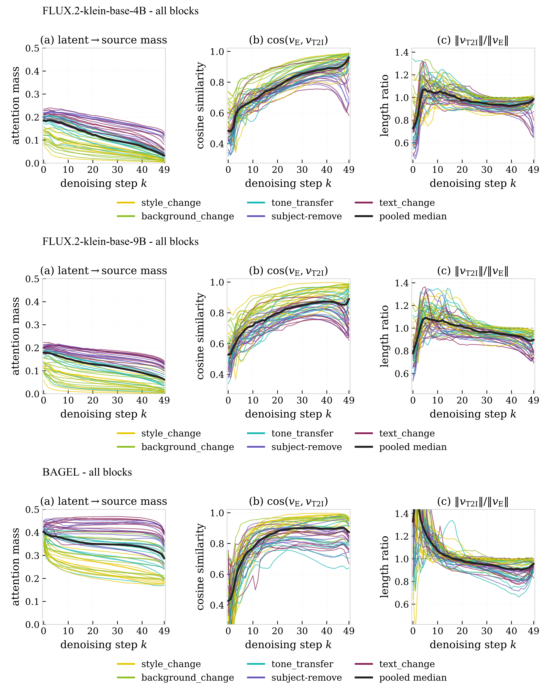

# Extended Figure 3

**Figure 3 extended to all 3 models using all transformer blocks.** (a) Source-attention mass generally decreases, while local edits retain high attention late in sampling. (b) Cosine similarity between editing and T2I velocity predictions. (c) T2I/edit prediction norm ratio. Both predictions are evaluated at identical latent states. Thin colored curves represent the same 50 samples (10 per category); black curves show pointwise medians. Panel (a) averages over all blocks, whereas the paper’s Fig. 3 uses only FLUX 4B’s 9 single-stream blocks 11–19 (zero-based). Y-axis ranges are shared across rows.
