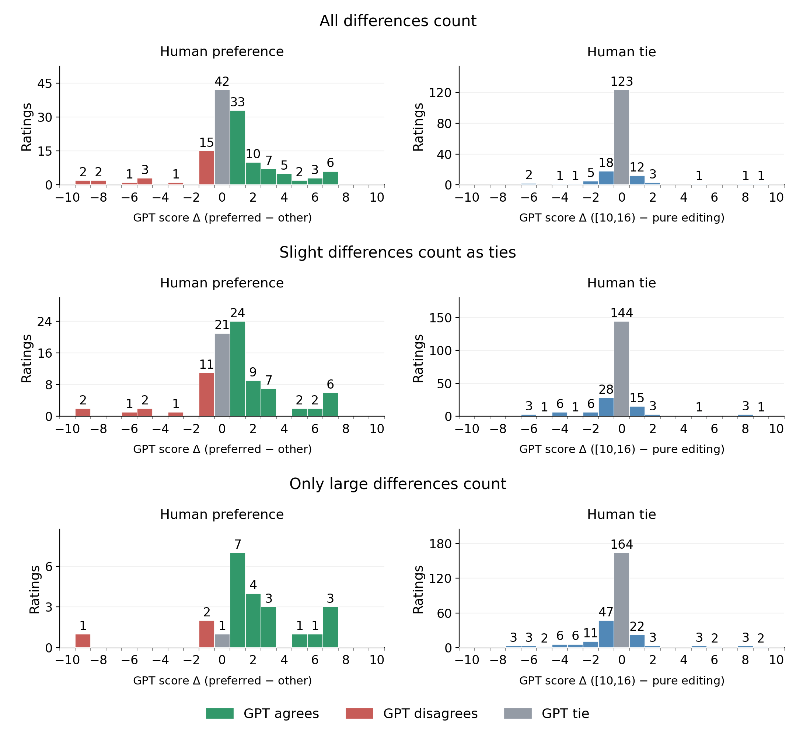

# Human–GPT preservation agreement

We compared human and GPT judgments of preservation in a side-by-side study.

* **Data:** 100 randomly selected GIE editing samples.
* **A/B options:** Pure editing vs. [10,16) (FLUX 4B).
* **Participants:** 15 people recruited from our professional networks, primarily lab colleagues.
* **Coverage:** 3 human ratings / sample.

With method identities hidden and A/B positions randomized, participants viewed both outputs alongside the source and the editing prompt. They chose which output better preserved unrelated details, or selected a tie. For a non-tie, participants rated the worse output’s unrelated changes relative to the source as:

* **Slight:** visible only on close inspection.
* **Clear:** visible during normal viewing.
* **Large:** substantial unwanted changes.

We show 3 ways of counting differences:

1) **All differences count**, including slight differences.
2) **Slight differences count as ties.**
3) **Only large differences count** (both slight and clear differences count as ties).

[Open full-resolution figure](https://raw.githubusercontent.com/pbnc5r6/conditioning-switching/main/rebuttal/human-gpt-agreement.png)

**Left:** GPT score differences, with positive values meaning agreement with the human preference. **Right:** For ties after applying each rule, positive values favor [10,16) and negative values favor pure editing. Histograms count individual ratings.

GPT largely agrees with human preferences, especially on large-difference cases. When humans report a tie, GPT also predominantly assigns equal scores. Together, these patterns show that GPT scores align well with human preservation judgments.

### Human preservation preferences

|                                  | Pure editing preferred | Tie | [10,16) preferred | No majority |
| -------------------------------- | ---------------------: | --: | ----------------: | ----------: |
| All differences count            |                     36 |  57 |                 5 |           2 |
| Slight differences count as ties |                     25 |  71 |                 3 |           1 |
| Only large differences count     |                      4 |  96 |                 0 |           0 |

The table counts distinct samples, using the majority of 3 ratings under each rule.

**Counting both clear and large differences, humans judged that [10,16) preserved unrelated details as well as or better than pure editing on 74% of samples.**
